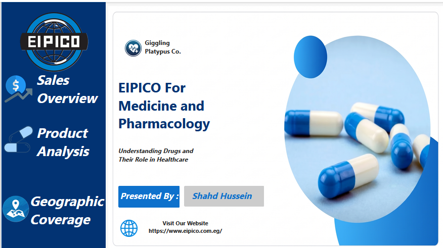
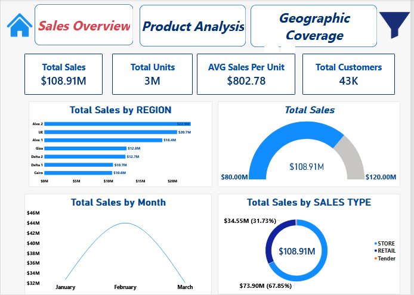
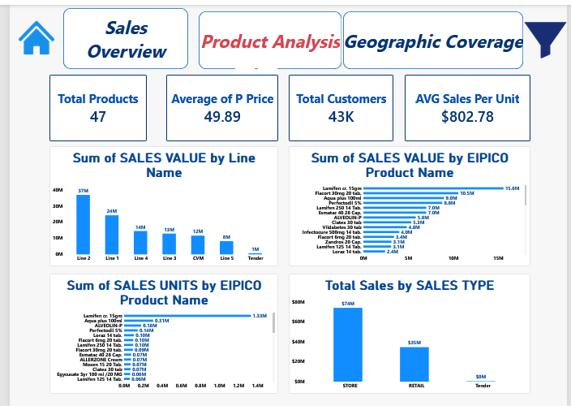
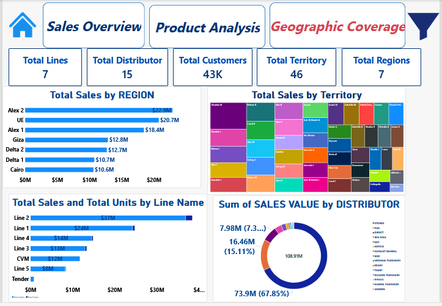

<div align="center">

# 💊 EIPICO Sales Performance Dashboard | Power BI
### Turning Pharmaceutical Sales Data into Business Insights

[](https://powerbi.microsoft.com/)
[](https://learn.microsoft.com/en-us/dax/)
[](#)

<p align="center">
  <b>An interactive Business Intelligence project exploring EIPICO's pharmaceutical sales performance across product lines, distributors, sales channels, and geographic regions and territories in Egypt.</b>
  <br />
  <i>Understanding Drugs and Their Role in Healthcare.</i>
</p>

</div>

---

## 📌 Project Overview

The **EIPICO Sales Performance Dashboard** is an interactive Power BI project built to explore pharmaceutical sales across product lines, individual medicines, distributors, sales channels, and geographic coverage.

The project transforms raw sales records into visual insights, helping decision-makers investigate sales trends, compare product lines, identify best-selling medicines by value and by units, and understand how sales are distributed across regions, territories, and distributors.

### 📋 Project at a Glance

| Project Detail | Description |
| :--- | :--- |
| **Project Name** | EIPICO Sales Performance Dashboard |
| **Company** | EIPICO (Egyptian International Pharmaceutical Industries Co.), [eipico.com.eg](https://www.eipico.com.eg/) |
| **Domain** | Pharmaceutical Sales Analytics |
| **Sales Period** | January – March (monthly view) |
| **Product Lines** | 7 (Line 1 – Line 5, CVM, Tender) |
| **Products** | 47 medicines |
| **Dashboard Pages** | 4 (Home, Sales Overview, Product Analysis, Geographic Coverage) |
| **Main Tool** | Microsoft Power BI Desktop |
| **Data Preparation** | Power Query (cleaning, column typing) |
| **Calculations** | DAX (explicit measures stored in a dedicated `All Measures` table) |

> **Important:** The data model is built around one flat sales table named `EIPICO`. Revenue is calculated from `SALES VALUE`, and units sold from `SALES UNITS`.

---

## 📸 Dashboard Preview

### 1. Cover / Home Page
<p align="center">
  
</p>

> *The landing page with project title, presenter credit, company website link, and navigation buttons to every report page.*

### 2. Sales Overview
<p align="center">
  
</p>

> *High-level KPIs (Total Sales, Total Units, Average Sales, Total Customers), sales by region, monthly trend, sales type split, and a gauge tracking total sales against a target range.*

### 3. Product Analysis
<p align="center">
  
</p>

> *Sales value by product line, top medicines by value and by units sold, and sales by sales type.*

### 4. Geographic Coverage
<p align="center">
  
</p>

> *Coverage view: sales by region, sales by territory (treemap), sales and units by product line, and sales share by distributor.*

---

## 📑 Table of Contents
- [Project Overview](#-project-overview)
- [Dashboard Preview](#-dashboard-preview)
- [Business Objectives](#-business-objectives)
- [Dataset](#-dataset)
- [Data Preparation](#-data-preparation)
- [Dashboard Pages](#-dashboard-pages)
- [Key Features](#-key-features)
- [Key Performance Indicators](#-key-performance-indicators)
- [Key Insights](#-key-insights)
- [DAX Measures](#-dax-measures)
- [Project Demonstration](#-project-demonstration)
- [Download Dashboard](#-download-dashboard)
- [Repository Structure](#-repository-structure)
- [Limitations & Considerations](#-limitations--considerations)
- [About the Author](#-about-the-author)
- [Feedback](#-feedback)

---

## 🎯 Business Objectives

The project explores the following analytical questions:

- **Revenue & Volume:** What are total sales, total units sold, and the number of customers served?
- **Product Line Contribution:** Which product lines (Line 1 – Line 5, CVM, Tender) drive the most revenue?
- **Product Performance:** Which medicines generate the most sales value, and which sell the most units?
- **Regional Performance:** How are sales distributed across regions (Alex 1, Alex 2, Delta 1, Delta 2, Cairo, Giza, UE) and the 46 territories?
- **Channel & Distributor Mix:** How much of the business comes from Store, Retail, and Tender sales, and which distributors carry the most volume?
- **Seasonality:** How do sales move from month to month?

---

## 📂 Dataset

The data model is simple: one flat sales table plus a dedicated table that holds all DAX measures.

### Dataset Tables

| Table | Type | Description |
| :--- | :--- | :--- |
| **`EIPICO`** | Data table | Sales records with `key`, `Month`, `REGION`, `Territory`, `DISTRIBUTOR`, `CUSTOMER NAME`, `Line Name`, `EIPICO Product Name`, `SALES TYPE`, `P Price`, `SALES VALUE`, `SALES UNITS`. |
| **`All Measures`** | Measures table | Holds every explicit DAX measure used in the report (Total Sales, Total Units, Total Customers, Total Products, and more). |

### Key Columns

| Column | Description |
| :--- | :--- |
| `Month` | Month of the sale (January – March). |
| `REGION` | Sales region (Alex 1, Alex 2, Delta 1, Delta 2, Cairo, Giza, UE). |
| `Territory` | Sales territory inside each region (46 in total). |
| `DISTRIBUTOR` | Distributor that carried the sale (15 in total). |
| `CUSTOMER NAME` | Customer that bought the product (about 43K). |
| `Line Name` | Product line the medicine belongs to. |
| `EIPICO Product Name` | Medicine name and presentation (for example, tablets, capsules, cream, solution). |
| `SALES TYPE` | Sales channel: Store, Retail, or Tender. |
| `P Price` | Product price. |
| `SALES VALUE` / `SALES UNITS` | Sales amount and number of units sold. |

---

## 🧹 Data Preparation

**Power Query** was used to prepare the dataset before reporting:

1. **Importing & Cleaning:** Loaded the sales data into a single flat table and checked the key columns (region, territory, distributor, product, line).
2. **Data Type Casting:** Applied currency format to sales values, whole numbers to units, and text format to descriptive columns.
3. **Measures Table:** Created a dedicated `All Measures` table to keep every DAX calculation in one place, separate from the data table.
4. **Navigation & Slicers:** Added slicer fields (Month, Region, Territory, Distributor, Line, Product, Customer, Sales Type) to support the filter pane on every page.

---

## 🗂️ Dashboard Pages

| # | Page | Purpose |
| :-: | :--- | :--- |
| 1 | **Home** | Cover page with title, presenter, website link, and navigation buttons. |
| 2 | **Sales Overview** | Total Sales, Total Units, AVG Sales, Total Customers; sales by region, month, and sales type; sales gauge. |
| 3 | **Product Analysis** | Total Products, Average Price, Total Customers; sales value by line; top medicines by value and by units; sales by sales type. |
| 4 | **Geographic Coverage** | Total Lines, Distributors, Customers, Territories, Regions; sales by region and territory; sales and units by line; sales share by distributor. |

---

## ✨ Key Features

- 🧭 **Custom navigation:** page buttons and a home button on every page.
- 🎛️ **Interactive filtering:** a pop-up slicer pane (opened from the funnel icon) with a **Clear all slicers** button, plus cross-highlighting between visuals.
- 🎨 **Consistent branding:** EIPICO blue and white palette across all pages.
- 📊 **Multiple visual types:** bar charts, column charts, donut charts, treemap, gauge, line chart, and KPI cards.
- 🧮 **Explicit DAX measures** stored in a dedicated measures table.

---

## 📈 Key Performance Indicators

| KPI | Value |
| :--- | :---: |
| **Total Sales** | $108.91M |
| **Total Units** | 3M |
| **AVG Sales Per Unit** | $802.78 |
| **Total Customers** | 43K |
| **Total Products** | 47 |
| **Average Product Price** | 49.89 |
| **Total Product Lines** | 7 |
| **Total Distributors** | 15 |
| **Total Territories** | 46 |
| **Total Regions** | 7 |

---

## 💡 Key Insights

### 🛒 Sales & Channels
- **Store** sales lead with **$73.90M (67.85%)** of total revenue, followed by **Retail** at **$34.55M (31.73%)**. **Tender** sales are almost negligible.
- Sales peak in **February** (roughly $44M), while **January** and **March** sit close to $32M.
- Total sales of **$108.91M** sit inside the dashboard's gauge range of $80M to $120M.

### 📦 Products & Lines
- **Line 2** is the biggest product line at **$37M**, followed by **Line 1** at **$24M**. Together they make up more than half of all sales.
- **Line 4 ($14M)**, **Line 3 ($13M)**, **CVM ($12M)**, and **Line 5 ($8M)** follow, while **Tender** contributes about **$1M**.
- **Lamifen cr. 15gm** is the top medicine by value at **$15.6M**, followed by **Flacort 30mg 20 tab.** (10.5M), **Aqua plus 100ml** (9.0M), and **Perfectodil 5%** (8.8M).
- **Lamifen cr. 15gm** also dominates volume with about **1.33M units**, far ahead of **Aqua plus 100ml** (0.31M), **ALVEOLIN-P** (0.18M), and **Perfectodil 5%** (0.14M). High-volume products are not always the highest in value, so value and units tell different stories.

### 🌍 Geographic Coverage
- **Alex 2** is the largest region at **$22.9M**, followed by **UE** (20.7M) and **Alex 1** (18.4M). Together the two Alexandria regions contribute about **$41.3M**.
- **Giza ($12.8M)**, **Delta 2 ($12.7M)**, **Delta 1 ($10.7M)**, and **Cairo ($10.6M)** complete the picture, so sales are spread across all seven regions.
- The business covers **46 territories** and **15 distributors**.

### 🚚 Distributors
- The largest distributor group carries **$73.9M (67.85%)** of sales, matching the Store channel share.
- The second-largest distributor accounts for **$16.46M (15.11%)**, and the next one for about **$7.98M**. The remaining distributors each hold a small share.

---

## 🧮 DAX Measures

The measures below reflect the logic behind the dashboard KPIs. The full, exact versions are inside the `.pbix` file.

```DAX
Total Sales = SUM ( EIPICO[SALES VALUE] )

Total Units = SUM ( EIPICO[SALES UNITS] )

AVG Sales Per Unit = AVERAGE ( EIPICO[SALES VALUE] )

Total Customers = DISTINCTCOUNT ( EIPICO[CUSTOMER NAME] )

Total Products = DISTINCTCOUNT ( EIPICO[EIPICO Product Name] )

Total Lines = DISTINCTCOUNT ( EIPICO[Line Name] )

Total Distributor = DISTINCTCOUNT ( EIPICO[DISTRIBUTOR] )

Total Territory = DISTINCTCOUNT ( EIPICO[Territory] )

Total Regions = DISTINCTCOUNT ( EIPICO[REGION] )
```

---

## 🎬 Project Demonstration

A full walkthrough of the dashboard is available as a video. Click the image or the link below to watch it:

<p align="center">
  <a href="EIPICO%20Dashboard.mp4">
    
  </a>
  <br />
  <b>▶️ <a href="EIPICO%20Dashboard.mp4">Watch the demo video</a></b>
</p>

---

## ⬇️ Download Dashboard

| File | Description |
| :--- | :--- |
| 📊 [**EIPICO Sales Performance.pbix**](EIPICO%20Sales%20Performance.pbix?raw=true) | The Power BI report file. Open it with **Power BI Desktop**. |
| 🎬 [**EIPICO Dashboard.mp4**](EIPICO%20Dashboard.mp4) | Video walkthrough of the project. |

---

## 🗃️ Repository Structure

```
📦 EIPICO-Sales-Performance-Dashboard
 ┣ 📄 README.md
 ┣ 📊 EIPICO Sales Performance.pbix
 ┣ 🎬 EIPICO Dashboard.mp4
 ┣ 🖼️ D1.PNG  (Home)
 ┣ 🖼️ D2.PNG  (Sales Overview)
 ┣ 🖼️ D3.PNG  (Product Analysis)
 ┗ 🖼️ D4.PNG  (Geographic Coverage)
```

---

## ⚠️ Limitations & Considerations

- This is a **descriptive analysis**; it does not include forecasting or statistical testing.
- The data covers only **three months (January – March)**, so seasonality conclusions are limited to that window.
- The model uses **one flat table** rather than a star schema, with no separate product, customer, or date dimensions.
- The dataset has **no cost information**, so profit and margin cannot be calculated.
- The **AVG Sales Per Unit** card ($802.78) is not total sales divided by total units. It reflects the average sales value per record, so read it with that in mind.
- **Tender** sales and the **Tender** line are very small, so they have little influence on overall results.
- Revenue is concentrated in a few lines and products (Line 2 and Line 1, and Lamifen cr. 15gm), so results are sensitive to those.

---

## 👤 About the Author

<div align="center">

**Shahd Hussein**
*Data Analyst | Power BI*

[](https://www.linkedin.com/feed/)

</div>

I build interactive dashboards that turn raw data into clear business insights. This project was created to practice data modeling, DAX, and dashboard storytelling in Power BI.

---

## 💬 Feedback

Feedback and suggestions are welcome. If you found this project useful:

- ⭐ Star the repository
- 🍴 Fork it and build your own version
- 💼 Reach out on [LinkedIn](https://www.linkedin.com/feed/)

<div align="center">

**Thank you for visiting! 💊**

</div>
